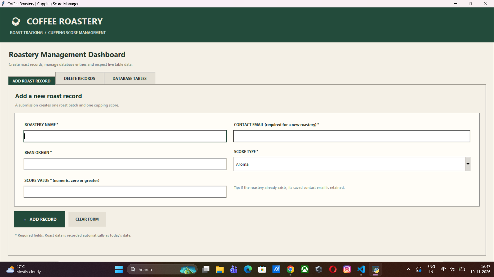
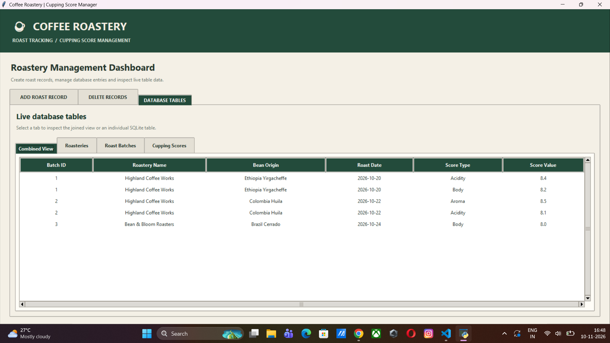
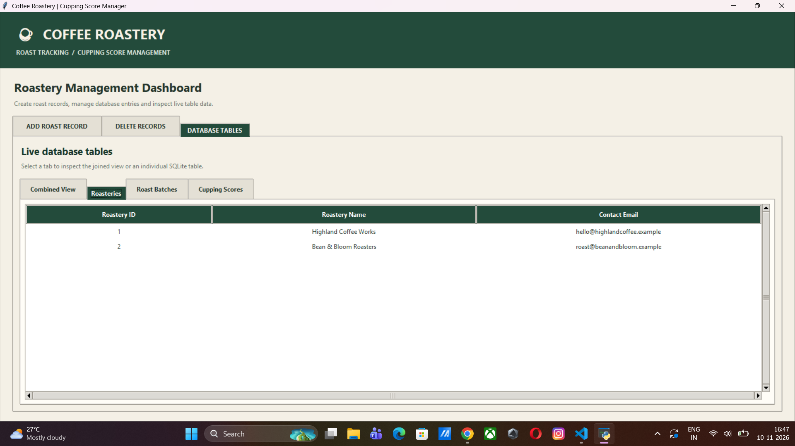
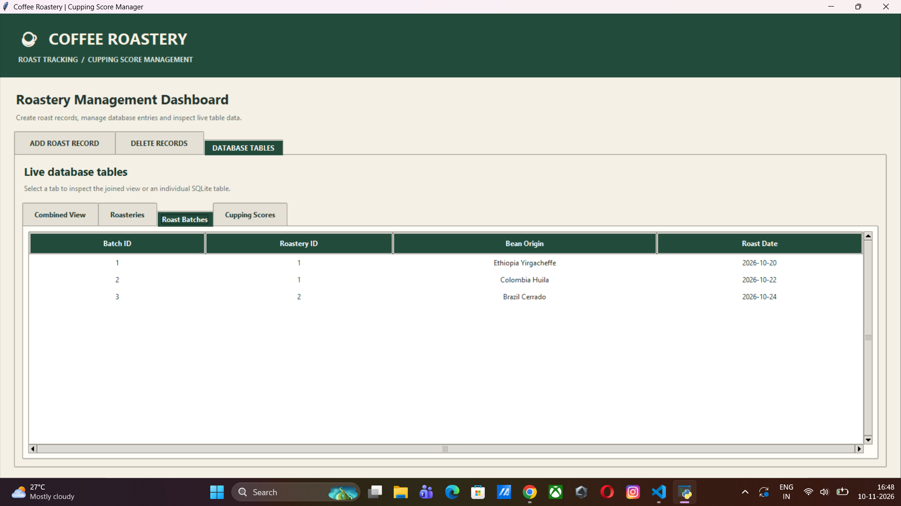
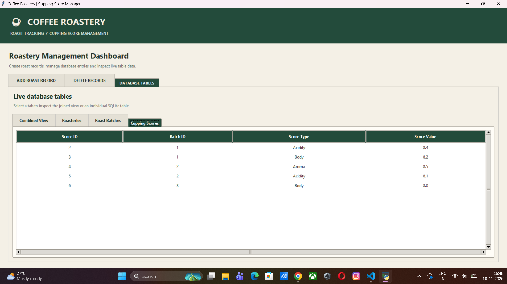

# ☕ Coffee Roastery & Cupping Score Management Dashboard

A Python-based desktop application designed to manage coffee roasteries, roast batches, and cupping scores using a relational SQLite database.

## 📌 Project Overview

This project replaces traditional spreadsheet-based coffee roast tracking with a structured database management system. It provides a graphical user interface (GUI) that allows users to insert, delete, and view coffee roasting records efficiently.

## 🚀 Features

- **Roastery Management:** Store roastery names and contact email addresses.
- **Roast Batch Management:** Maintain bean origin and roast date records.
- **Cupping Score Management:** Record aroma, acidity, body, and other coffee quality scores.
- **Automatic Record Creation:** Reuses existing roastery IDs or creates new roastery profiles.
- **Cascading Deletes:** Automatically removes dependent records when a parent record is deleted.
- **Live Database Views:** Displays combined JOIN results and individual database tables.
- **Input Validation:** Prevents blank entries and invalid or negative score values.
- **Automatic Database Initialization:** Creates and seeds the database when all three tables are empty.

## 🛠️ Technologies Used

| Technology | Purpose |
|---|---|
| Python | Application programming |
| SQLite | Relational database |
| Tkinter | Graphical user interface |
| ttk | GUI widgets and tabbed layouts |

## 🗄️ Database Architecture

The application uses three relational database tables:

### 1. Roasteries
Stores roastery information.
- roastery_id (Primary Key)
- roastery_name (Unique)
- contact_email

### 2. Roast Batches
Stores coffee roasting batch information.
- batch_id (Primary Key)
- roastery_id (Foreign Key)
- bean_origin
- roast_date

### 3. Cupping Scores
Stores coffee quality evaluation records.
- score_id (Primary Key)
- batch_id (Foreign Key)
- score_type
- score_value

### Relationships

- One roastery can have multiple roast batches.
- One roast batch can have multiple cupping scores.
- Foreign keys maintain relational integrity.
- ON DELETE CASCADE ensures dependent records are automatically deleted.

## 💻 Installation & Execution

### Requirements
- Python 3.x
- Tkinter (usually included with standard desktop Python installations)
- SQLite3 (included in Python's standard library)

### Steps

1. Clone this repository:

   `git clone https://github.com/Sam5781/Coffee-Roastery-Cupping-Score-Management.git`

2. Open the project folder.

3. Run the application:

   `python coffee_roastery.py`

4. The application window will open, allowing you to manage coffee roasting records.

**Note:** Tkinter requires a desktop environment. Standard hosted Google Colab sessions do not support normal desktop Tkinter windows.

## 📊 Application Screenshots

Screenshots of the application will be added here.

## 👨‍💻 Project Information

**Project:** Building a Relational Coffee Roastery & Cupping Score Management Dashboard

**Database:** SQLite

**Interface:** Python Tkinter

---

## 📸 Application Screenshots

### 1. Main Dashboard

### 2. Combined Database View

### 3. Roasteries Table

### 4. Roast Batches Table

### 5. Cupping Scores Table

